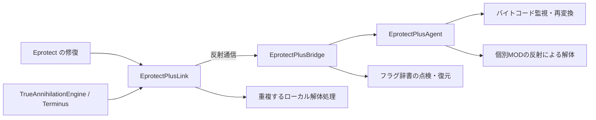

# Eprotect+ の整理・解析と改良案

2026-10-08 / CODEX。現行ソースのレビューと、Java 17 の隔離した再現プログラムによる確認。今回は製品コードを変更せず、改良の順序と検証条件をまとめる。

## 結論

最初に直すべきなのは、特権フラグの復元漏れ、例外後の二重実行、対象不明時の一覧全消去、結果未確認の成功判定。次にクラスローダーを含むバイトコード管理と接続状態を整理する。最後に特化処理の重複・再変換の負荷・ログを改善する。

現行の Eprotect+ は「JVM処理を提供する層」と「ゲーム内の個体を解体する層」が混在している。別クラスローダーは通信・依存を分ける境界であり、ThreadLocal は独自の協調用フラグ。いずれも他MODに対する万能の権限や不可侵の隔離ではない。

## 1. 現在の役割とつながり

| 部品 | 実際の担当 | 整理したい点 |
|---|---|---|
| `EprotectPlusAgent` | Instrumentation 登録、初回バイトコード保存、再変換の検査、反射による個別MOD解体 | バイトコード処理とゲーム内解体を分ける |
| `ClassSummary` | クラスファイルの手書きパーサー、コードCRC・短いreturnの検出 | 算出した指紋を判定に使っていない。検知範囲を明示する |
| `EprotectPlusBridge` | 接続状態、イベント、統計、特権フラグ、強化期限、実行の委譲 | 起動成功と接続を区別。同期ログI/Oを外す |
| `EprotectPlusLink` | MOD側からの反射通信、ローカル状態、保護対象の修復、エージェントなしの解体処理 | 通信の失敗と委譲したactionの失敗を分ける。特化解体を移す |
| `FlagDictionaryAgent` | `protect/flag/` の再変換時に初回バイトコードを返す | EprotectPlusAgent と保護範囲が重なる。正当な再変換も復元ログになる |
| `FlagDictionaryProtector` | 独立したマスター辞書、分類、MOD側辞書の点検・復元 | 正当な設定を保持し、内容改ざんを検出する |
| `TrueAnnihilationEngine` 等 | プレイヤー・保護対象の除外、ゲーム内の実際の抹殺パイプライン | エージェントの成功値と最終消去の確認を分ける |



守る側の Observer / LifeGuard / ValkyrieProtect / agentcommon は Claude の担当。改良案はその担当コードを直接編集する前提にはしていない。

## 2. 最優先の修正

### P0-1: 特権フラグの復元とactionの一回実行

根拠: `EprotectPlusLink.java:94` / `:117`。

LOCAL_PRIVILEGED を true にしてからエージェント呼び出しが成功すると、ローカルフラグを戻す finally の外で return する。既知の `retransformEnforcerAndStackCloaking` 失敗と一致する。

さらに `Method.invoke` が投げた例外を一括で握りつぶし、ローカルの action.run へ進む。委譲先でactionが既に走って例外を出した場合、actionをもう一度実行する。入れ子では内側の再実行も起こり得る。呼び出し先の例外が InvocationTargetException に包まれることは [Java 17公式仕様](https://docs.oracle.com/en/java/javase/17/docs/api/java.base/java/lang/reflect/InvocationTargetException.html) による。

改良: エージェントとローカルの両方を外側の try/finally に入れる。委譲前の機能探索失敗だけフォールバックし、InvocationTargetException の cause は呼び出し元へ伝える。フラグは前の値へ戻し、外側が false の場合は ThreadLocal.remove も検討する。

検証: エージェントあり/なし × 正常/例外/入れ子。action実行回数は一回、外側のフラグ値は実行前と一致すること。全GameTestに入る前に、この小さな検証を先に通す。

### P0-2: 対象不明なら他個体の一覧を消さない

根拠: `EprotectPlusAgent.java:418` / `:502` と `EprotectPlusLink.java:478` / `:708`。

Flashfurのcoreが見つからない場合に null を一覧削除へ渡し、削除条件が `target == null || ...` なので一覧全体を解体する。エージェント側の `neutralizeFlashfur` は任意の対象から呼ばれる。Omni-Mobs がいる環境で、別のモブの抹殺が Flashfur 全体へ波及し得る。

Java 17 の再現で、`--add-opens java.base/java.util=ALL-UNNAMED` を付けると無関係な2要素が0要素になった。通常設定では内部フィールドへの反射が失敗し、例外を握りつぶして2要素のままだった。開発環境と配布環境で能力・副作用が変わる点も問題。

改良: null は何もしない。確認できた対象・相互参照するcore・UUIDだけを照合する。既存の `StaticReferencePurger` と、`ModProtectionBreaker` の対象限定の後始末へ寄せる。ArrayListの内部配列操作は既存の削除拒否対策に限定し、対応できない場合は理由を返す。全体削除は単体抹殺APIに含めない。

検証: coreあり/なし、空の一覧、無関係なcoreが並ぶ一覧、通常JDK設定、削除を拒否する一覧。対象以外の要素が残ること。

### P0-3: 「解体を試した」と「抹殺が完了した」を分ける

根拠: `EprotectPlusAgent.java:238` / `:730`、`EprotectPlusLink.java:606`。

エージェント側は各反射操作の失敗を握りつぶし、最後に true と完全消滅のログを返す。最終処理は主に `setHealth(0)` と `deathTime=19` であり、死亡・ワールド除去の確認がない。ローカル側も末尾で success=true にする。

再現プログラムでは、HP変更を拒否するJDKだけの模擬対象に `reportedSuccess=true, healthStill=20.0, deathTime=19` が返った。これはAPIの成功判定の欠陥を示すが、実ゲームの最終パイプライン全体が失敗する証拠ではない。TrueAnnihilationEngine には後続処理がある。

改良: 戻り値を段階の結果にする。クラスローダー間は JDK 標準型で、`attempted` / `changed` / `unsupported` / `failed` と失敗理由を返す。最終消去の確認はMOD側で DirectRead とワールドの追跡状態を使う。成功・復元の統計は確認後に加算する。

エージェント側の `runPrivilegedBypass` は例外で null を返し、boolean に自動変換する呼び出し元で NullPointerException になり得る。この戻り値契約も同時に直す。

検証: HP setter拒否、getter偽装、除去拒否、再登録、反射メソッドなし。処理試行だけで「完全消滅」を記録しないこと。

## 3. 保護と接続の信頼性

### P1-1: クラス名だけで基準バイトコードを共有しない

根拠: `EprotectPlusAgent.java:34` / `:117`、`FlagDictionaryAgent.java` の BASELINE_BYTECODE。

保存キーがクラス名だけなので、同名クラスを異なるローダーが読み込むと最初のbytesが共有される。異なるクラス定義を復元先に返すリスクがある。隔離したcallback再現で、2つのローダーから同じ名前を渡しても最初のbytesが残ることを確認した。この再現はコールバックへの合成入力であり、JVMへ誤った定義を適用する実験ではない。

改良: ローダーの同一性とクラス名をキーにする。ローダーの弱参照と破棄時の掃除、bootstrapのnullローダー、基準未取得を扱う。初回に観測したbytesを無条件に「未改ざん」と呼ばず、観測順序・取得元・時刻を残す。late attach時は基準未取得を診断に出す。

### P1-2: 未知の呼び出しと正当な再変換を区別する

根拠: `EprotectPlusAgent.java:207` / `:220`、`ClassSummary.java`、`FlagDictionaryAgent.java`。

外部判定は既知の文字列リストへの部分一致。未知のMODの変更は、メソッドが限定された短いreturnにならない限り見逃し得る。ClassSummaryが計算するCRCは変更判定に使われない。trueのreturn、Floatの0、例外を投げる処理、条件だけを反転する変更などはその短いreturn判定の対象外。

FlagDictionaryAgentは入力が同じでも再変換時に基準を返し、外部干渉を拒否したログを出す。再現でも `flagIdenticalInputRestored=true` となった。これは改ざんの確認なしに保護成功が増えることを意味する。

改良: 呼び出し元を「内部・外部・不明」に分け、既知MOD文字列は補助情報にする。Eprotect+側で内部の復元依頼を明示し、守る側の自己点検と通常の処理を混同しない。検知した変更と実際に返した復元bytesを別々に記録する。

コード比較は生bytesやCRCだけで決めない。再変換では定数プールの順序が変わり得るため、意味を正規化した比較・検査対象メソッドを検討する。[Java 17 Instrumentation仕様](https://docs.oracle.com/en/java/javase/17/docs/api/java.instrument/java/lang/instrument/Instrumentation.html#retransformClasses(java.lang.Class...))。前段の変換器が観測できるのはその位置までのbytesであり、後段の変換結果を完全に監視できると保証しない。

### P1-3: 起動状態・接続・クラスローダーを明示する

根拠: `EprotectPlusLink.java:58`、`EprotectPlusBridge.java:54`、`EprotectPlusAgent.start`。

Linkは探索開始時に looked=true とし、見つからなかった結果を固定する。遅延attach後の再接続ができず、並行呼び出しでは探索途中のnullも見える。Bridgeのactive=trueはtransformer登録より先なので、登録失敗後も稼働中と表示し得る。startはinstrumentationを先に保存するため、失敗後の再試行も早期returnになる。

エージェント内の1引数 Class.forName は通常エージェント自身のローダーを使う。対象のローダーにしかいない他MODのhelperは見つからない可能性がある。これはForgeの実環境で各helperのローダーを測る必要がある。

改良: `UNAVAILABLE / STARTING / ACTIVE / DEGRADED` を分け、登録成功後にACTIVEへ遷移する。APIをキャッシュし、遅延attachは間隔を空けて再探索する。対象クラスのローダーを基準にhelperを探索し、未初期化の他MODを勝手に初期化しない。通信方式と対応機能を診断へ出す。

### P1-4: プレイヤーと個別対策の境界を統一する

エージェント側のプレイヤー判定は `getClass().getName().contains("Player")`。異なる名前のPlayer派生クラスを見逃し、名前だけ似た非プレイヤーを誤判定する可能性がある。外側の TrueAnnihilationEngine は instanceof Playerで除外するが、直接APIや他の執行経路まで同じ保証とは言えない。

また Link の inspectAndBypassInterference は個別Counterを直接呼び、エージェント解体にも SpecificCountermeasures の制御がない。Eprotect.repair からLinkへは無条件で入るため、外部MODありの genericOnly で個別対策が混ざり得る。前回の外部MODなしgenericOnlyテストでは、この問題を測れていない。

改良: プレイヤー/保護対象/試験対象/実行モードをMOD側で判定し、JDK型の実行要求として渡す。エージェント側も検証する。特化処理はモードを明示して選び、準汎用処理は既存層を使う。SuperSteveの安全モードは起動時の環境対策として別に維持する。AgtCallback.INSTの差し替えは他エージェントの同一性判定へ影響するため、成功保証として扱わず必要性を再評価する。Madnessの変換器は外さない。

## 4. 性能と保守性

### P2-1: 再変換をまとめ、結果を正確に返す

現行の retransformCriticalClasses は全ロードクラスを走査し、`com/automatavalkyries/` 全体などprefixに一致するものをまとめて再変換する。Entity prefixは EntityType 等にも一致し得る。強化開始時に同期実行される。

改良: 正確な対象名と必要なパッケージに絞る。干渉を検知した対象の保留一覧、最低間隔、同時実行防止で要求をまとめる。1200サーバーTick程度の定期点検は候補だが、緊急の復元と分ける。全クラス数ではなく「要求・変換・復元・失敗」の件数と処理時間を返す。JVMの一括再変換は例外時に全体が適用されないため、無条件の細分化ではなく依存を考えたグループを使う。

### P2-2: 変換コールバックから同期ファイル書き込みを外す

Bridge.recordEventは同期メソッド内で毎件flushする。変換中のI/O待ちがクラスロード・再変換を長引かせ得る。保護ログには干渉ログと同じ間引きがなく、辞書の正当な再変換でも増える。

改良: 上限付きのイベントキューとまとめ書き、同じ対象・原因の集約、落とした件数の表示。変換コールバックで新たな複雑なクラスロードを起こさない構成にする。性能の影響量は未測定であり、現時点では構造からの懸念。

LinkのLOCAL_EVENTSは書き込み時にクラスのモニター、読み取り/clear時にdequeのモニターを使い、ロックが一致しない。Bridge/Linkのstatsもsizeを同じロックで読んでいない。ログ同期を整理する際に修正する。

### P2-3: MODごとの解体を1か所に集める

Witherzilla / SuperSteve / Pig2 / 猫雫 / Flashfur の処理が Agent、Link、ModProtectionBreaker、Counterに分散する。片側だけ改善されると、エージェントあり/なしで結果が変わる。

改良: ゲーム内の型・mappingを扱う解体は MOD 側の担当クラスへ寄せ、エージェントは Instrumentation と観測を中心にする。特殊な執行が残る場合は、対象限定のアダプターと対応能力を明示する。ルール・結果形式を共通にし、クラスローダー境界にはJDK型だけを渡す。

### P2-4: フラグ辞書の内容・設定・修復の成功を分ける

Protectorの点検は主にMapやListの件数と空判定。件数を保った語彙の差し替えは検出できない。復元時はactiveをマスターだけで作り、BUILT_INも上書きするため、正当なextra設定がactiveから落ちる可能性がある。ignoreは別状態だが、復元後の設定再適用まで含めて確認が必要。

改良: 組み込みの内容検証と、ユーザー設定を合成したactiveの検証を分ける。修復は組み込み辞書を戻した後に設定を再適用し、結果を確認して統計を加算する。Claude担当のFlagDictionaryを編集する必要が出たら、必要な連携APIだけをユーザーへ伝える。

### P2-5: 強化時間と説明を実際の能力に合わせる

triggerReinforcedProtectionTicks は ticks×50 を実時間へ変換している。サーバーTickで測る期間とは異なる。期限に currentTimeMillis を使うため時計補正の影響もある。

改良: ゲーム内の強化期限は既存のサーバーTick方針との整合を確認し、JVM側の時間間隔はnanoTime等の単調時間で測る。仕様を推測で変更しない。強化中も通常ダメージが上限どおり通る現行方針を守る。

runCloakedのdoPrivilegedはスタックを消す機能ではなく、前回のJava17再現でも呼び出し元が残った。「完全スタック偽装」「未装着でも同等」「不可逆・完全消滅」は対応能力と検証済み結果に置き換える。

## 5. 推奨する整理後の構成

- Link: 接続、対応APIの解決、呼び出し一回の保証、ローカルフラグの範囲管理。
- Bridge: JDK型のAPI、状態、上限付き記録、処理結果。
- Agentの内部部品: 基準バイトコード管理、変換判定、再変換要求の集約。初期化入口は薄くする。
- MOD側: 既存のCounter/ModProtectionBreaker/抹殺エンジンを使い、対象判定・特化モード・最終結果を管理。
- 辞書保護: Eprotect+と専用エージェントの対象・登録を整理し、2つのtransformerが同じ範囲を復元する状態を解消する。現在はstartのガードがあるため、専用jarを指定しただけで必ず3つ目のtransformerが増えるとは限らない。

## 6. 検証結果と実装の順序

今回の隔離再現は、現行 `src/eprotectplus` の6ソースをjavacでコンパイルし、`build/codex-research/EprotectPlusAuditProbe.java` から直接呼んだ。Minecraft・外部MOD・実際のInstrumentationは起動していない。

```text
reportedSuccess=true, healthStill=20.0, deathTime=19
nullTargetListSize=2                         # 通常のJava17設定
nullTargetListSize=0                         # java.utilをadd-opensした別実行
sameNameDifferentLoadersKeptFirstBaseline=true
flagIdenticalInputRestored=true
```

callbackの確認は合成入力であり、実際の複数ローダーでのゲーム起動や改ざんの全ケースを検証した結果ではない。

推奨順序:

1. P0のフラグ復元・一回実行・対象限定・成功契約を修正する。
2. エージェント有無/例外/入れ子/対象不明を小さな回帰テストで確認する。
3. ローダー別の基準とACTIVE状態を整理する。遅延attach・登録失敗も検証する。
4. 特化処理の重複とgenericOnlyの境界を整理し、外部MODを一つずつ付けて測る。
5. 再変換・ログの処理時間を測り、対象限定と間引きを適用する。
6. build、通常GameTest、genericOnly、守る側3エージェント＋Eprotect+を確認する。既知の羊テストと新規失敗を区別する。

前回の323件のGameTest結果は `CODEX_GENERALIZATION_PROGRESS.md` にあり、Eprotect+併用時の既知のフラグ漏れも残っている。今回、製品コードを変えていないため全GameTestの再実行はしていない。分析資料と隔離した確認だけを追加し、コミットしていない。
