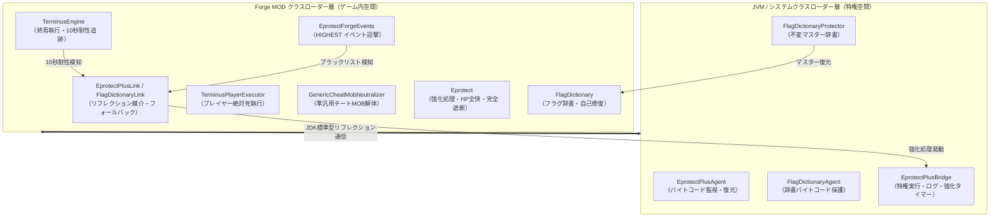

# Eprotect+ Java エージェント・終焉執行（Terminus）・高次元防御 アーキテクチャ仕様書

**最終更新**: 2026-10-02  
**対象環境**: Minecraft 1.20.1 / Forge 47.4.23 / Java 17 (`official` mappings)  
**関連主要パッケージ**:
- `com.automatavalkyries.eprotectplus`（Java エージェント層・システムクラスローダー常駐）
- `com.automatavalkyries.eprotectplus.flag`（フラグ辞書保護エージェント）
- `com.automatavalkyries.protect.plus`（MOD 側リンク・フォールバック層）
- `com.automatavalkyries.protect.flag`（準汎用フラグ辞書）
- `com.automatavalkyries.annihilate`（終焉・真抹殺エンジン）

---

## 1. 全体アーキテクチャ概要

本システムは、Minecraft や Forge の通常のゲーム内スコープを越え、**JVM（Java 仮想マシン）およびクラスローダーの特権レベル**で動作する絶対的防御・即死機構です。



### 3 層防護構造
1. **JVM 特権層（`src/eprotectplus`）**:
   - `java.lang.instrument.Instrumentation` によるバイトコードの監視・復元。
   - MOD クラスローダーから独立したシステムクラスローダーに常駐し、チート MOD のリフレクションや Unsafe から物理的に隔離。
2. **MOD リンク・調停層（`protect/plus`, `protect/flag`）**:
   - リフレクションを用いてエージェント層と安全に通信。
   - エージェント未装着環境（スタンドアロン起動時）でも同等の処理を代替実行するローカルフォールバックエンジンを内包。
3. **ゲーム内迎撃・執行層（`protect`, `annihilate`）**:
   - Forge イベント（`EventPriority.HIGHEST`）での攻撃迎撃。
   - 終焉機能（Terminus）によるチート MOB・無敵プレイヤーの不可逆的解体。

---

## 2. Java エージェントの仕組み（JVM レベル防護基盤）

### 2.1 EprotectPlusAgent
- **エージェント定義**: `Premain-Class` / `Agent-Class` を備え、`-javaagent:automata_valkyries-eprotect-plus.jar` として起動。
- **バイトコード完全性保護**:
  - `ClassFileTransformer` により、監視対象（`com/automatavalkyries/protect/` 等）の初回ロード時バイトコード（`BASELINE_BYTECODE`）を保持。
  - 外部のチート MOD（Witherzilla, IMDS, Hyperlink 等）が `retransformClasses` / `redefineClasses` を悪用して保護メソッドを空化（`return false;` など）しようとした場合、改ざんを即座に検知し、未改ざんバイトコードを強制返却して改ざんを無力化。
- **特権実行コンテキスト（`runPrivileged`）**:
  - `ThreadLocal<Boolean>` による特権フラグ制御。
  - Metapotent Flashfur 等の「攻撃元のスタックトレースを検査して即死を拒絶する検閲機構（`StackChecker`）」を、エージェント空間から呼び出すことで完全に欺瞞・迂回。

### 2.2 FlagDictionaryAgent & FlagDictionaryProtector
- **不変マスター辞書**:
  - `FlagDictionaryProtector.MASTER_DICTIONARY` に、全 9 カテゴリー（`KILL`, `CONTROL`, `HEALTH_TAMPER`, `GUARD`, `BYPASS`, `REVIVE`, `COUNT`, `TIMER`, `BANISH`）の語彙を完全保持。
- **バイトコード保護**:
  - `FlagDictionaryAgent` が `FlagDictionary` クラスへの ASM / Transformer 介入を遮断。
- **自動整合性検証・自己修復（`verifyAndRepair`）**:
  - チート MOD がリフレクションや Unsafe で MOD 側の `FlagDictionary.active` や `BUILT_IN` を `clear()` した場合、エージェント側からマスターデータで瞬時に再構築・上書き復元。

### 2.3 エージェント・ブリッジ通信仕様
- **クラス**: `com.automatavalkyries.eprotectplus.EprotectPlusBridge`
- **通信原則**: クラスローダー境界を越えるため、引数・戻り値はすべて JDK 標準型（`String`, `Map`, `List`, `long`, `boolean`）のみを使用。
- **主要 API**:
  | メソッド | 説明 |
  |---|---|
  | `triggerReinforced(durationMs, reason)` | 指定ミリ秒間の Eprotect+ 強化処理を発動 |
  | `isReinforced()` | 現在強化モード中かを判定 |
  | `getReinforcedRemainingMs()` | 強化モードの残り時間をミリ秒で取得 |
  | `resetReinforced()` | 強化モードを即時解除（テスト・戦闘終了用） |
  | `annihilateTarget(Object entity)` | エージェント特権空間から対象の真抹殺を実行 |
  | `verifyAndRepairFlagDictionary(Class<?>)` | フラグ辞書の整合性を点検し、改ざんがあれば復元 |

---

## 3. 即死・終焉（Terminus / 真抹殺）ロジックの仕組みと仕様

終焉（Terminus）は、チート MOB や無敵プレイヤーを**5 段階の多層パイプライン**で解体・抹殺します。

```
[終焉発動 (executeTerminus)]
   │
   ├─▶ 【第 1 段階】Forge イベント・DirectRead 貫通
   │      - イベントキャンセルを阻止、直接フィールド読み出し
   │
   ├─▶ 【第 2 段階】プレイヤー絶対終焉 (TerminusPlayerExecutor)
   │      - クリエイティブ / スペクテイター ➔ サバイバル強制降格
   │      - abilities.invulnerable = false
   │      - 不死トーテム / 未知チート防具 / 身代わりアイテムをインベントリから強制消滅
   │      - PersistentData の無敵・神モードタグ全消去
   │      - HP 0.0F ➔ 死亡演出確定
   │
   ├─▶ 【第 3 段階】準汎用チート MOB 解体 (GenericCheatMobNeutralizer)
   │      - フラグ辞書走査により、未知フィールドの無敵・防御・HP固定を 0 / false 化
   │      - 死亡フラグ (isDead, removed) を true 化
   │      - 終了・解体メソッド (close, dispose, cleanup) の強制実行
   │
   ├─▶ 【第 4 段階】本体・コントローラー・静的リスト解体 (ModProtectionBreaker)
   │      - 代理 (Proxy) と 本体 (Core) の相互参照追跡 ➔ Core の強制破棄
   │      - static な復活待機キュー (List / Set / Map) から UUID・インスタンスを抹消
   │      - 全タイマー (beamTimer, eraseTimer 等) を -9999 に凍結
   │
   └─▶ 【第 5 段階】JVM Java エージェント特権真抹殺 (EprotectPlusAgent)
          - 特権コンテキスト (runPrivileged) で StackChecker を完全迂回
          - Witherzilla の witherzillaLife を強制剥奪
          - Metapotent FlashfurLevel の全体メモリから強制除外
          - No-Sugar / IMDS の抹殺登録テーブルから除外
```

### 3.1 終焉の 10 秒耐性検知メカニズム
- **クラス**: [`TerminusEngine`](file:///C:/Users/sfdge/mc-mods/automata_valkyries/src/main/java/com/automatavalkyries/annihilate/TerminusEngine.java)
- **追跡マップ**: `Map<UUID, TargetRecord>`（発動時刻・開始 Tick を記録）。
- **判定条件**: 終焉を受けた対象が、**200 ticks（10 秒）または 10,000ms 経過してもなお生存（`isAlive() && !isRemoved()`）している場合**。
- **カウンター発動**: 異常なチート耐性を検知した瞬間、[`EprotectPlusLink.triggerTerminusResistedReinforcement`](file:///C:/Users/sfdge/mc-mods/automata_valkyries/src/main/java/com/automatavalkyries/protect/plus/EprotectPlusLink.java#L152) を呼び出し、味方・保護対象に対して **10 秒間の Eprotect+ 強化処理** を自動実行。

---

## 4. 防御・保護（Eprotect+ / 強化処理）の仕組みと仕様

### 4.1 通常 Eprotect と Eprotect+ 強化処理の比較

| 項目 | 通常の Eprotect | Eprotect+ 強化処理（Reinforced Mode） |
|---|---|---|
| **被ダメージ上限** | 10秒の窓で最大HPの10%まで | **完全 0.0F（完全遮断・イベントキャンセル）** |
| **ブラックリストMOD相手** | 10秒の窓で最大HPの1%まで（罰則） | **完全 0.0F 遮断 ＋ 10 秒間強化モード自動起動** |
| **毎 Tick 修復** | 崩れた状態を点検して修復 | **HP を最大値（getMaxHealth）に即時全快固定** |
| **死亡演出タイマー** | 通常進行（正規撃破時のみ許可） | **`deathTime = 0` に毎 Tick 強制リセット** |
| **外部状態・即死リスト** | 検出時にパージ | **`KillLists.purge` ＆ `ForeignStateCleaner.clean` を毎 Tick 強制執行** |
| **持続時間** | 常時稼働 | **発動から 10 秒間（10,000ms / 200 ticks）** |

### 4.2 強化処理の発動トリガー
1. **ブラックリスト MOD からの攻撃・干渉検知**:
   - `EprotectForgeEvents.onLivingAttack` / `onLivingHurt` で攻撃元が `ModBlacklist.contains(modId)` の場合。
   - `triggerBlacklistReinforcement(sourceMod)` が発動。
2. **終焉機能への 10 秒耐性検知**:
   - `TerminusEngine.checkResistanceAll()` で対象が 10 秒耐え続けた場合。
   - `triggerTerminusResistedReinforcement(target)` が発動。

---

## 5. フラグ辞書（FlagDictionary）の仕様と双方向連携

### 5.1 カテゴリー一覧と役割
| カテゴリー | 意味・役割 | 代表的なキーワード |
|---|---|---|
| `KILL` | 死亡・消去・抹消・呪い | `dead`, `death`, `=die`, `eras`, `remov`, `kill`, `annihil`, `terminus` |
| `CONTROL` | 停止・凍結・封印 | `freez`, `frozen`, `stun`, `timelock`, `chronolock`, `*timestop`, `*noai` |
| `HEALTH_TAMPER` | HP の固定・不正増減 | `zerohp`, `damagecap`, `hpoverride`, `*healthlock`, `*shielddelta` |
| `GUARD` | 無敵・保護・免除 | `protect`, `immun`, `invuln`, `shield`, `immortal`, `godmode`, `undying` |
| `BYPASS` | 守りの迂回・貫通 | `bypass`, `penetrat`, `*truedamage`, `*ignoreprotect`, `*antiinvul` |
| `REVIVE` | 復活の許可 | `reviv`, `respawn`, `resurrect`, `rebirth`, `*undyingcore` |
| `COUNT` | 残り回数・残機 | `count`, `remaining`, `=lives`, `charges` |
| `TIMER` | 時間・待機時間 | `delay`, `timer`, `cooldown`, `duration` |
| `BANISH` | 追放・奈落落とし | `banish`, `voidfall`, `relocat`, `*forcedimension` |

### 5.2 単語分割・照合ルール
- **キャメルケース・スネークケース対応**: `markedForDeath` ➔ `["marked", "for", "death"]`
- **接頭辞 `*`**: 単語をつなげた文字列に含まれる（例: `*timestop` ➔ `timestop`）
- **接頭辞 `=`**: いずれかの単語と完全一致（例: `=die` ➔ 単語 `die` のみ合致、`soldier` や `studied` の取り違えを防止）
- **接頭辞なし**: いずれかの単語の前方一致（例: `kill` ➔ `killed`, `killer`）

---

## 6. ビルド・起動・テスト手順

### 6.1 Gradle ビルドタスク
```powershell
# MOD 本体のコンパイル
.\gradlew.bat compileJava

# Eprotect+ Java エージェント jar のビルド
.\gradlew.bat eprotectPlusJar

# フラグ辞書防護 Java エージェント jar のビルド
.\gradlew.bat flagDictionaryAgentJar

# 全エージェントおよび MOD の一括ビルド
.\gradlew.bat assemble
```

### 6.2 起動プロパティ
- **`-PwithEprotectPlus`**: Eprotect+ Java エージェント（`-javaagent:build/libs/automata_valkyries-eprotect-plus.jar`）を装着して起動。
- **`-PwithFlagAgent`**: フラグ辞書防護エージェント（`-javaagent:build/libs/automata_valkyries-flag-agent.jar`）を装着して起動。
- **一括起動スクリプト**: `./run_client_with_agent.bat`（対話形式で各種エージェント・MOD 同梱モードを選択可能）。

### 6.3 GameTest 自動検証
```powershell
# Eprotect+ および全エージェントを有効化して全 86 件の GameTest を実行
.\gradlew.bat compileJava eprotectPlusJar flagDictionaryAgentJar runGameTestServer -PwithEprotectPlus --no-daemon
```
